# Tienda Render: tu API en internet y tu app consumiéndola

Proyecto de la **Clase 2** de **DSY1104 Desarrollo Full Stack II**. Es la misma API de productos de la Clase 1 (Spring Boot + Neon), ahora preparada para:

1. vivir en internet, en **Render**, con una URL pública `https://...onrender.com`;
2. no dormirse, gracias a un **robot (UptimeRobot)** que la visita cada 5 minutos;
3. ser consumida desde una **app React Native (Expo)** en tu celular.

```
 Celular con Expo Go                     Render (plan Free)                    Neon
┌──────────────────┐   HTTPS + JSON   ┌──────────────────────────┐   SQL   ┌────────────┐
│ app-movil (RN)   │ ───────────────► │ Spring Boot en Docker    │ ──────► │ PostgreSQL │
│ fetch(API_URL…)  │ ◄─────────────── │ /api/productos           │ ◄────── │ productos  │
└──────────────────┘   200/201/400…   │ /api/health              │         └────────────┘
                                      └──────────────────────────┘
                                                 ▲
                         UptimeRobot ────────────┘  GET /api/health cada 5 min
                         (el "robot")               para que Render no la duerma
```

**¿Por qué no basta con `localhost`?** `localhost` significa "este mismo computador". Si la app corre en tu **celular**, `localhost` es el celular, no tu PC: la app nunca encuentra la API. Por eso la API tiene que estar en internet.

**Palabras que vas a ver**

| Palabra | Qué significa |
|---|---|
| Render | Empresa que ejecuta tu backend en internet. Su plan **Free** es gratis. |
| Deploy (desplegar) | Subir una versión de tu código para que quede funcionando en internet. |
| Docker / `Dockerfile` | Receta que dice cómo construir y ejecutar tu app. Render no trae Java: con el `Dockerfile` arma una "caja" que sí lo tiene. |
| Variable de entorno | Un dato (como la clave de Neon) que se entrega al programa desde afuera, sin escribirlo en el código. Es lo mismo que tu `.env`, pero en Render. |
| Health check | Una ruta simple (`/api/health`) que responde "estoy vivo". |
| Dormir (*spin down*) | Render Free apaga tu API si pasan **15 minutos** sin visitas. La siguiente visita la despierta, pero tarda **cerca de 1 minuto**. |
| UptimeRobot | Servicio gratis que visita tu URL cada 5 minutos. Así tu API nunca cumple 15 minutos sin visitas. |
| Expo Go | App del celular que ejecuta tu proyecto React Native sin instalar nada más. |
| CORS | Regla del **navegador** que bloquea llamadas a otra dirección si el backend no la permite. La app en el celular (Expo Go) no la usa. |

## Requisitos

| Necesitas | Detalle |
|---|---|
| Cuenta de **GitHub** | La usarás para entrar a Render y a UptimeRobot. |
| Tu base de **Neon** de la Clase 1 | Con sus 3 datos: `DB_URL`, `DB_USERNAME`, `DB_PASSWORD` (el contenido de tu `.env`). Si no la tienes, sigue los pasos 1 y 2 del README de la Clase 1: https://github.com/Umbingelelo/tienda-neon |
| **Postman** | Ahora sirve **también la versión web**, porque la API ya no está en `localhost`. |
| **Node.js 22 LTS o superior** (mínimo 22.13) | Solo para la app (parte final). Descárgalo en https://nodejs.org. Para comprobarlo: `node -v`. |
| **Expo Go** en tu celular | Desde Play Store o App Store. Este proyecto usa **Expo SDK 58**: instala la versión más reciente de Expo Go. |

No necesitas tarjeta de crédito para nada de esto.

---

## Las rutas de esta API (el contrato)

Una **ruta** es método + dirección. Estas son todas las de la tienda. La **URL base** es la de tu servicio, por ejemplo `https://tienda-los-tres.onrender.com`.

| Método | Ruta | Body | Éxito | Errores posibles |
|---|---|---|---|---|
| GET | `/api/health` | — | **200** `{"estado":"ok"}` | — |
| GET | `/api/productos` | — | **200** + lista | — |
| GET | `/api/productos?nombre=pol` | — | **200** + lista filtrada | — |
| GET | `/api/productos/{id}` | — | **200** + producto | **404** si no existe, **400** si el id no es número |
| POST | `/api/productos` | producto en JSON | **201** + header `Location` + producto con su `id` | **400** campos inválidos o JSON mal formado, **415** sin `Content-Type` |
| PUT | `/api/productos/{id}` | producto **completo** en JSON | **200** + producto actualizado | **400**, **404** |
| DELETE | `/api/productos/{id}` | — | **204** sin cuerpo | **404** |

**Cómo se nombran:** sustantivo en **plural** (`productos`), minúsculas, sin verbos en la URL (el verbo es el **método**: GET, POST, PUT, DELETE). El `{id}` va en la ruta porque identifica **un** producto; los filtros van después de `?` (*query params*).

| ❌ Mal | ✅ Bien |
|---|---|
| `GET /api/getProductos` | `GET /api/productos` |
| `POST /api/crearProducto` | `POST /api/productos` |
| `GET /api/borrarProducto?id=3` | `DELETE /api/productos/3` |
| `GET /api/producto/3` (singular) | `GET /api/productos/3` |

**Un producto** se ve así:

```json
{ "id": 1, "nombre": "Polerón", "descripcion": "Con capucha", "precio": 24990, "stock": 10, "imagenUrl": null }
```

**Validaciones** (están en `Producto.java`; las revisa `@Valid` en el controller):

| Campo | Regla | Mensaje si falla |
|---|---|---|
| `nombre` | obligatorio, máximo 100 caracteres | `El nombre es obligatorio` |
| `precio` | obligatorio, 0 o más | `El precio es obligatorio` / `El precio no puede ser negativo` |
| `stock` | obligatorio, 0 o más | `El stock es obligatorio` / `El stock no puede ser negativo` |
| `descripcion`, `imagenUrl` | opcionales, máximo 500 caracteres | `... puede tener como máximo 500 caracteres` |

**Todos los errores tienen la misma forma** (los arma `ManejadorErrores.java`), así el frontend siempre sabe dónde mirar:

```json
{
  "status": 400,
  "error": "Bad Request",
  "mensaje": "Hay campos inválidos",
  "ruta": "/api/productos",
  "campos": {
    "nombre": "El nombre es obligatorio",
    "precio": "El precio no puede ser negativo"
  }
}
```

`campos` aparece solo cuando falla una validación (el orden de sus claves puede variar). Un 404 se ve así: `{"status":404,"error":"Not Found","mensaje":"Producto 99 no existe","ruta":"/api/productos/99"}`.

---

## Paso 0: Tener tu código en GitHub

Render despliega **desde un repositorio de GitHub**. Elige **una** opción:

### Opción A (recomendada): copiar esta plantilla

1. Arriba en esta página, presiona el botón verde **Use this template** → **Create a new repository**.

   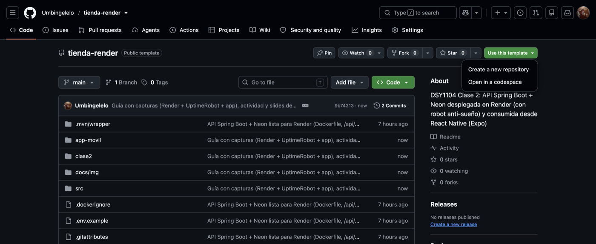

2. **Owner:** tu usuario. **Repository name:** `tienda-<nombre-de-tu-equipo>`, por ejemplo `tienda-los-tres`. Puede ser **Public** o **Private**: Render funciona con los dos. Presiona **Create repository**.

   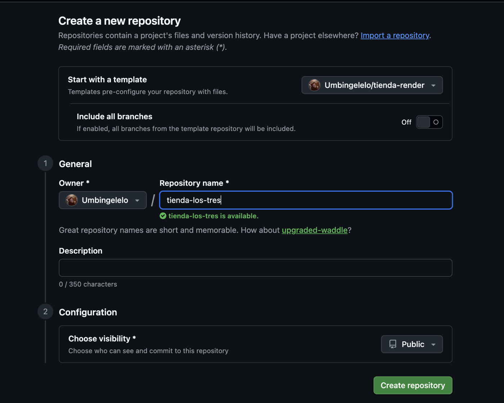

### Opción B: usar el backend de tu equipo (el de la Clase 1)

Tu backend de la Clase 1 no tiene todo lo que usa esta guía (el filtro `?nombre=`, el header `Location`, los mensajes en español, `/api/health`, la app). Copia estos archivos de esta plantilla a tu repositorio. Descárgala con **Code → Download ZIP** para tener los archivos a mano.

`...` es la carpeta de tu **paquete principal**: la que contiene tu clase `...Application.java` (la que tiene `@SpringBootApplication`). En la Clase 1 es `src/main/java/cl/duoc/tiendaneon/`.

| Archivo de esta plantilla | Dónde va en tu repo | Para qué |
|---|---|---|
| `Dockerfile` y `.dockerignore` | En la raíz, junto a `pom.xml` | Para que Render pueda construir tu API. |
| `salud/SaludController.java` | `.../salud/` (crea la carpeta) | La ruta `/api/health` para el robot. |
| `config/ManejadorErrores.java` | `.../config/` | Errores en JSON con `campos`. Si ya tienes otra clase con `@RestControllerAdvice`, bórrala: dos se pisan. |
| `producto/Producto.java`, `producto/ProductoRepository.java`, `producto/ProductoController.java` | `.../producto/`, **reemplazando** los tuyos | Mensajes en español, filtro `?nombre=` y header `Location`. Si en la Clase 1 agregaste un atributo propio (por ejemplo `categoria`), vuelve a agregarlo: el campo con su validación, su getter/setter y su línea en `actualizar(...)`. |
| la carpeta `app-movil/` completa | En la raíz | La app de la Parte D. |

Después de copiar:

1. **La primera línea (`package`) de cada `.java` copiado** debe ser tu paquete principal + la carpeta. Si tu clase principal dice `package com.misequipo.tienda;`, el controller de salud dice `package com.misequipo.tienda.salud;`. Si usaste el proyecto de la Clase 1 tal cual (`cl.duoc.tiendaneon`), no cambies nada.
2. En `application.properties`, revisa estas dos líneas (la Clase 1 ya trae la primera; la segunda agrega el puerto 8081 de Expo web):

   ```properties
   server.port=${PORT:8080}
   app.cors.allowed-origins=${CORS_ORIGINS:http://localhost:8081,http://localhost:5173,http://localhost:3000,http://localhost:4200}
   ```
3. Si tu `pom.xml` dice `<java.version>21</java.version>`, en el `Dockerfile` cambia `maven:3.9-eclipse-temurin-17` por `maven:3.9-eclipse-temurin-21` y `eclipse-temurin:17-jre` por `eclipse-temurin:21-jre`. `ManejadorErrores` necesita Spring Boot 3.2 o superior (la Clase 1 usa 4.1).
4. **Prueba en tu PC antes de subir:** ejecuta la API y abre `http://localhost:8080/api/health`. Debe mostrar `{"estado":"ok"}`. Si da 404, el `package` de `SaludController` quedó mal (paso 1).
5. Crea los archivos que empiezan con punto (`.dockerignore`) **desde VS Code** (Explorer → New File…): el Bloc de notas los guarda como `.txt`.
6. `git add .` → `git commit -m "Preparado para Render"` → `git push`.

Si tu `pom.xml` está en una subcarpeta del repositorio (por ejemplo `backend/`), anótalo: lo necesitas en el paso 3.

> En las dos opciones: **tu `.env` NO debe estar en GitHub.** Entra a tu repositorio en el navegador y confirma que no aparece un archivo `.env`. Si aparece, bórralo y cambia la clave en Neon (**Reset password**), porque ya es pública.

## Paso 1: Crear tu cuenta en Render

> Las capturas son reales y se tomaron en noviembre de 2026. Si Render cambia un botón de lugar, busca el mismo texto.

1. Entra a **https://dashboard.render.com/register**.
2. Presiona **GitHub** (no uses email: con GitHub, Render ve tus repositorios directamente). Autoriza a Render.
3. Si te pregunta para qué usarás Render, responde cualquier opción.

   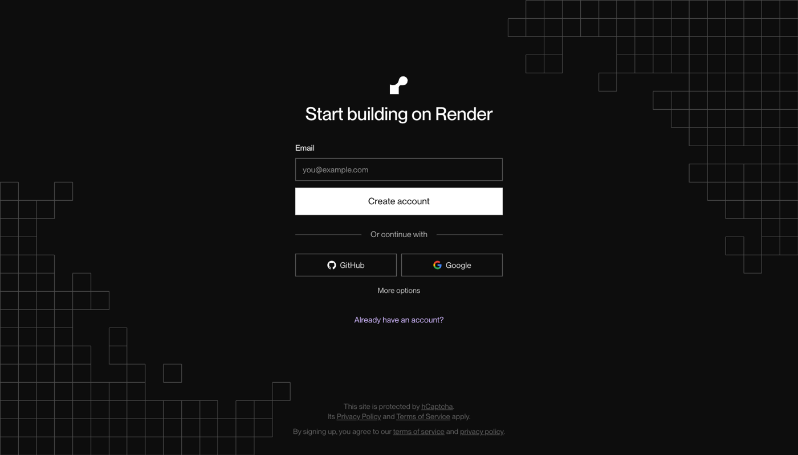

**Una cuenta de Render por equipo.** La crea **un** integrante (el mismo repositorio sirve para todos). Lee el porqué en el paso 8.

## Paso 2: Crear el Web Service y elegir el repositorio

1. En el panel verás **Create a new Service**. En la tarjeta **Web Services**, presiona **New Web Service →**.
   *Si no ves esa pantalla, usa el botón **+ New** (arriba a la derecha) → **Web Service**.*

   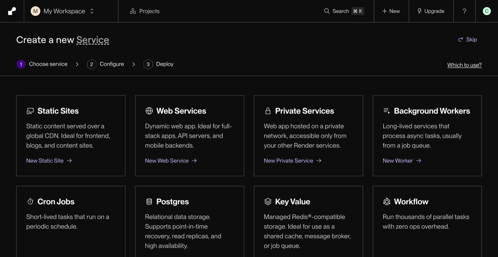

2. En **Source Code** deja la pestaña **Git Provider** y presiona **GitHub**.

   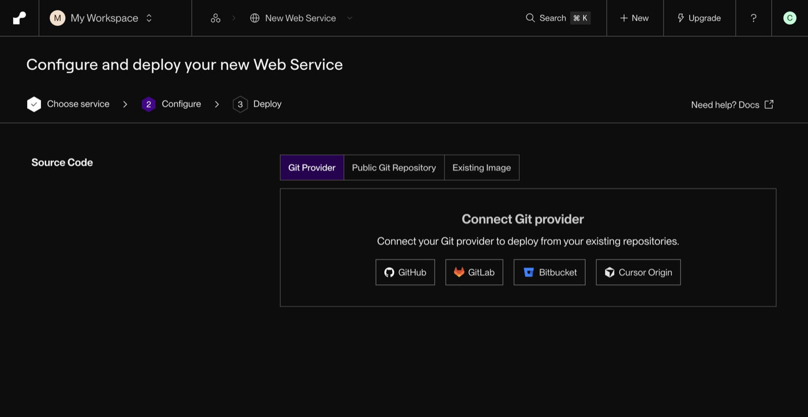

   *¿En vez del botón **GitHub** ves directamente una lista de repositorios? Render ya está conectado: salta al punto 4. Si tu repositorio no aparece en esa lista, abre **Credentials** (a la derecha del buscador), configura GitHub y agrégalo en **Select repositories**.*

3. Se abre GitHub preguntando dónde instalar Render. Elige **tu usuario**. Luego marca **Only select repositories**, abre **Select repositories**, busca tu repositorio (`tienda-...`) y selecciónalo. Presiona **Install**.
   *GitHub puede pedirte confirmar con tu clave, con la app GitHub Mobile o con un código: es normal.*

   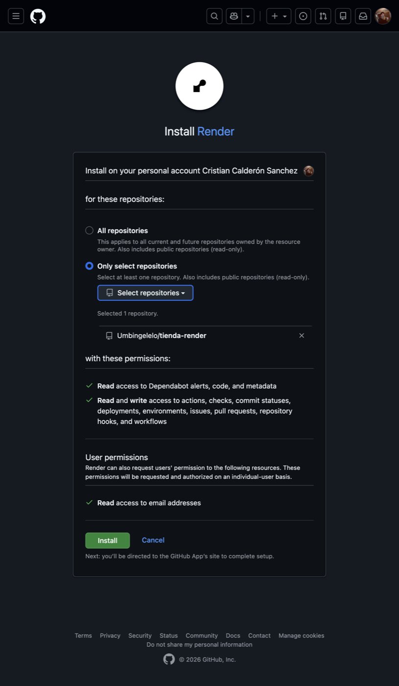

4. Vuelves a Render. Escribe el nombre de tu repositorio en el buscador y haz clic en él. (En las capturas el repositorio se llama `tienda-render`; tú busca el tuyo, `tienda-<equipo>`.)

   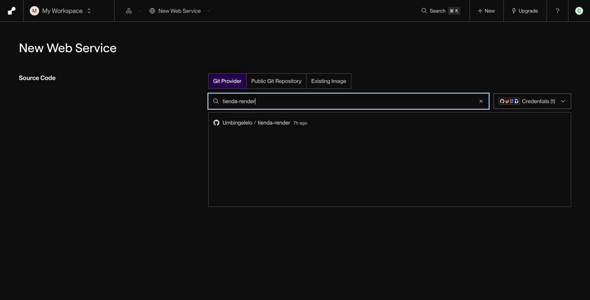

## Paso 3: Configurar el servicio

Render detecta el `Dockerfile` y muestra *"It looks like you're using Docker"*. Completa así (si aparece un campo **Project**, déjalo vacío):

| Campo | Qué poner |
|---|---|
| **Name** | Viene relleno con el nombre del repo: reemplázalo por `tienda-<nombre-de-tu-equipo>`. Será parte de tu URL. |
| **Language** | **Docker** (ya viene elegido). |
| **Branch** | `main` |
| **Region** | **Virginia (US East)**: es la más cercana a tu base de Neon en São Paulo. Puede verse como lista o como tarjetas. |
| **Root Directory** | Vacío. *(Solo si tu `pom.xml` está en una subcarpeta, por ejemplo `backend/`, escribe esa carpeta.)* |

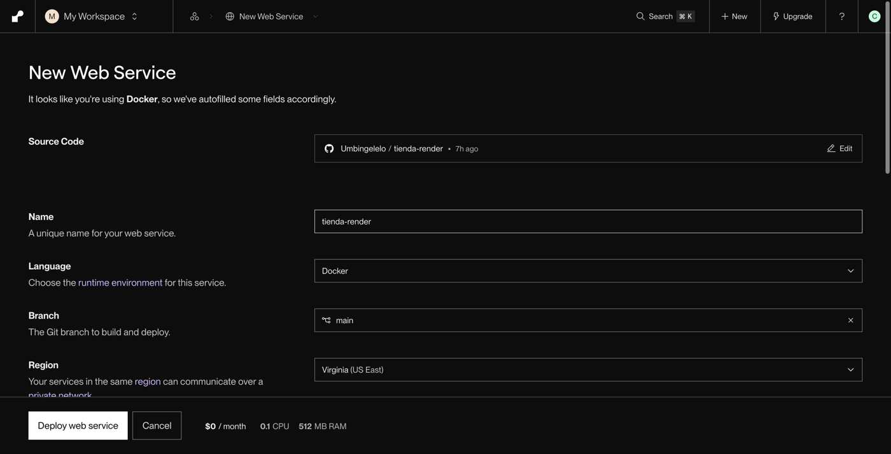

**Compute (plan):** ⚠️ Render deja marcado por defecto el plan de **$7 / month**. En la sección **Compute** elige la **primera** fila, **$0 / month · Free**. La barra de abajo de la página debe decir **$0 / month**.

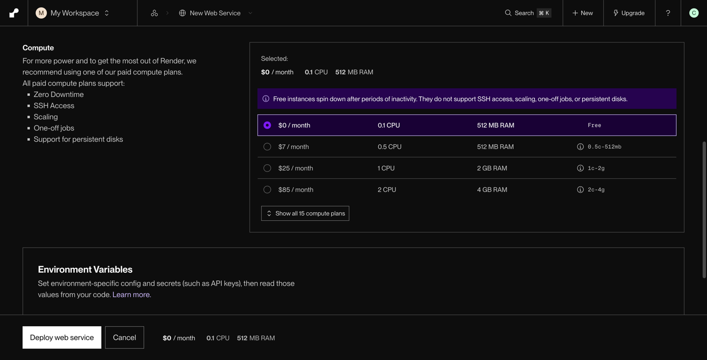

## Paso 4: Variables de entorno (tu `.env`, pero en Render)

Tu `.env` no está en GitHub (bien hecho), así que Render no tiene las claves de Neon. Se las entregas aquí:

1. En **Environment Variables**, presiona **Add from .env**.
2. Pega **el contenido de tu `.env`**, las mismas 3 líneas de la Clase 1, **sin comillas**:

   ```properties
   DB_URL=jdbc:postgresql://ep-xxxx-xxxx.c-2.sa-east-1.aws.neon.tech/neondb?sslmode=require
   DB_USERNAME=neondb_owner
   DB_PASSWORD=npg_tu_clave
   ```

   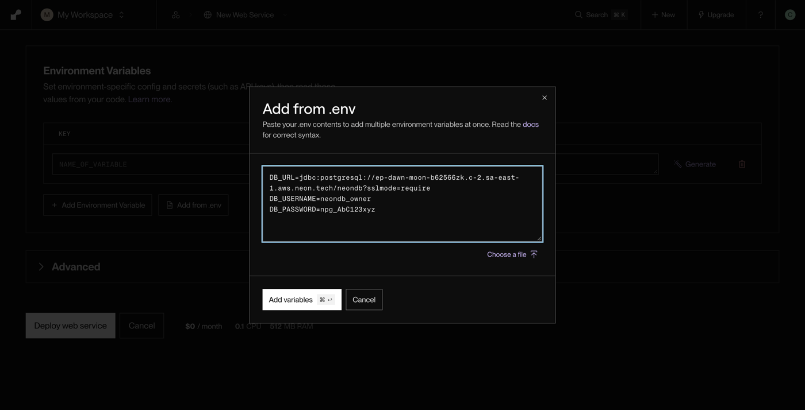

3. Presiona **Add variables**. Deben quedar 3 filas: `DB_URL`, `DB_USERNAME` y `DB_PASSWORD`. Render oculta los valores con puntos; con el ícono del ojo puedes revisarlos.

   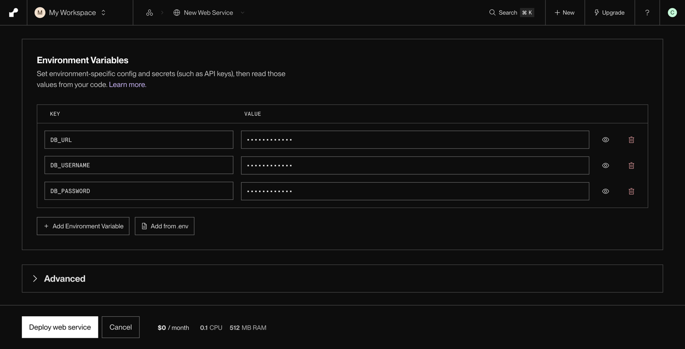

> Revisa lo mismo que en la Clase 1: `DB_URL` empieza con `jdbc:postgresql://`, termina en `?sslmode=require` y no tiene `&channel_binding=require`.

## Paso 5: Health Check Path

1. Abre la sección **Advanced** (más abajo).
2. En **Health Check Path** escribe: `/api/health` (el `/healthz` gris es solo un ejemplo: el campo está vacío).

   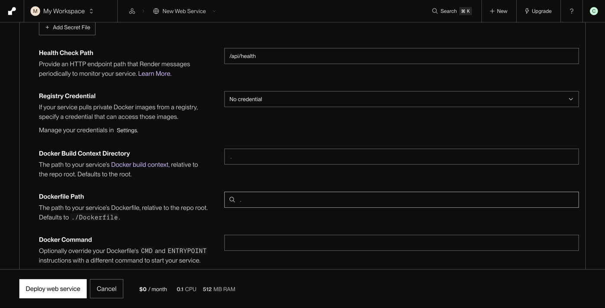

Con esto Render sabe cuándo tu API terminó de arrancar y si sigue viva. El resto de **Advanced** se deja como está. **No uses Secret Files**: tus claves ya están en el paso 4.

## Paso 6: Desplegar

1. Presiona **Deploy web service** (abajo a la izquierda).
2. Render muestra el deploy con sus **logs** (la consola de tu API, pero en internet). Primero construye la imagen con Maven (2 a 5 minutos la primera vez) y luego arranca Spring Boot (1 a 2 minutos más).
3. **Funcionó si** aparecen estas líneas:

   ```
   Started ...Application in XX seconds        <- el nombre y el número cambian
   ==> Your service is live 🎉
   ==> Available at your primary URL https://tienda-....onrender.com
   ```

   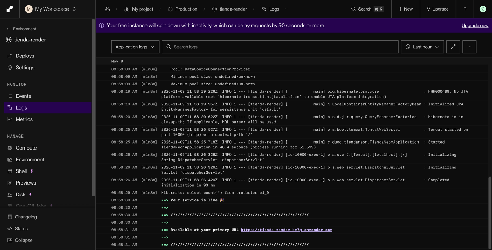

4. Haz clic en **Deploys** (menú izquierdo). Tu **URL pública** aparece arriba, bajo el nombre del servicio, junto a la etiqueta verde **Live**. Cópiala: la usarás en todo lo que sigue.

   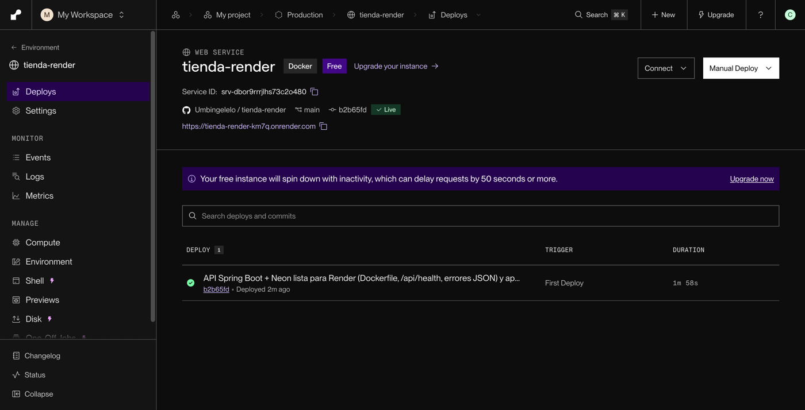

Si abres la URL sola verás `{"status":404,...,"mensaje":"La ruta / no existe"}`: **es normal**, la API solo tiene rutas bajo `/api/...`.

Si el deploy falla, busca en los logs las líneas que dicen `Caused by:`: la **última** suele ser la causa real. Luego revisa **Problemas frecuentes** al final.

> **Cada `git push` a `main` vuelve a desplegar solo** (*Auto-Deploy*). Para ver en qué va, entra a **Events** o **Logs** en el menú izquierdo.

## Paso 7: Probar tus rutas en internet

1. En el navegador abre `https://TU-URL.onrender.com/api/health`. Debe mostrar `{"estado":"ok"}`.
2. Abre `https://TU-URL.onrender.com/api/productos`. Verás los productos de **tu** base de Neon: los mismos que veías en `localhost` en la Clase 1.
3. En **Postman**, prueba estas peticiones (para las que llevan body: **Body → raw → JSON**):

| # | Petición | Body | Código esperado |
|---|---|---|---|
| 1 | `GET /api/productos` | — | **200** |
| 2 | `GET /api/productos?nombre=pol` | — | **200** (solo los que contienen "pol") |
| 3 | `POST /api/productos` | `{"nombre":"Gorro","precio":8990,"stock":12}` | **201**. Abajo, en los **Headers de la respuesta**: `Location: /api/productos/{id}` |
| 4 | `POST /api/productos` | `{"nombre":"","precio":-1}` | **400** con `campos` (también aparece `stock`, porque no lo enviaste) |
| 5 | `POST /api/productos` | `{"nombre": ` (JSON roto a propósito) | **400** `El JSON está mal formado` |
| 6 | `GET /api/productos/99999` | — | **404** `Producto 99999 no existe` |
| 7 | `DELETE /api/productos` (sin id) | — | **405** método no permitido |
| 8 | `DELETE /api/productos/{id que devolvió la petición 3}` | — | **204** (sin cuerpo) |
| 9 | `POST /api/productos` con **Body → raw → Text** (no JSON) | `hola` | **415** `Envía el body como JSON...` |

**¿Para qué sirve `Location`?** Es la ruta del producto recién creado: con un `GET` a esa ruta lo vuelves a pedir sin buscar su id.

**Ojo:** `/api/productos/` (con `/` al final) responde **404**. Escribe las rutas sin `/` final.

**La primera petición puede tardar hasta 1 minuto** si la API estaba dormida. Después responde rápido. Eso lo arregla el paso 8.

## Paso 8: El robot que no deja dormir a tu API (UptimeRobot)

Render Free apaga tu API después de **15 minutos sin visitas**. UptimeRobot la visita cada **5 minutos**, así nunca llega a 15.

1. Entra a **https://dashboard.uptimerobot.com/sign-up**.
2. En **Website to monitor** pega tu URL **con `/api/health` al final**: `https://TU-URL.onrender.com/api/health`
3. Presiona **Github** y autoriza.

   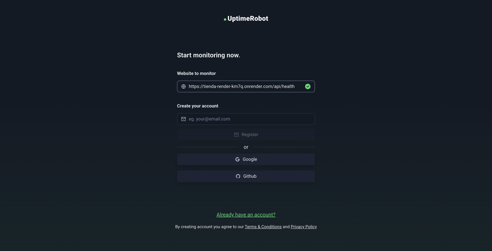

4. UptimeRobot crea el monitor solo y avisa *"We'll start checking it every 5 minutes"*. En las preguntas siguientes deja **Email** marcado (te avisa si tu API se cae), presiona **Next** y luego **Skip onboarding** → **Skip onboarding**. **No agregues más monitores.**

   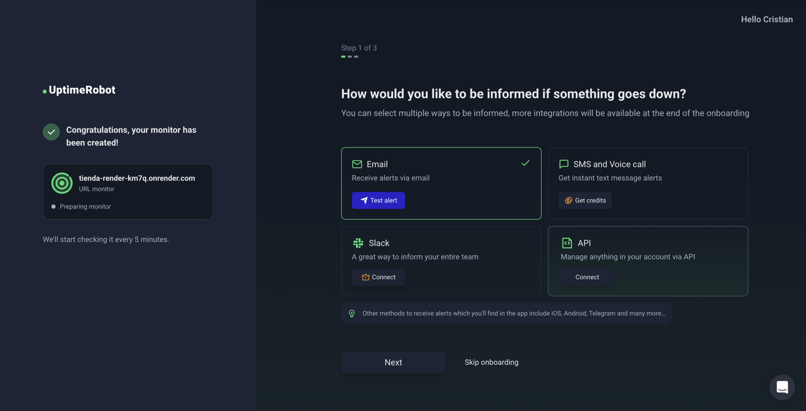

5. En **Monitoring** (menú izquierdo; la página se titula **Monitors**) verás tu monitor. A los pocos minutos queda en verde: **Up**.

   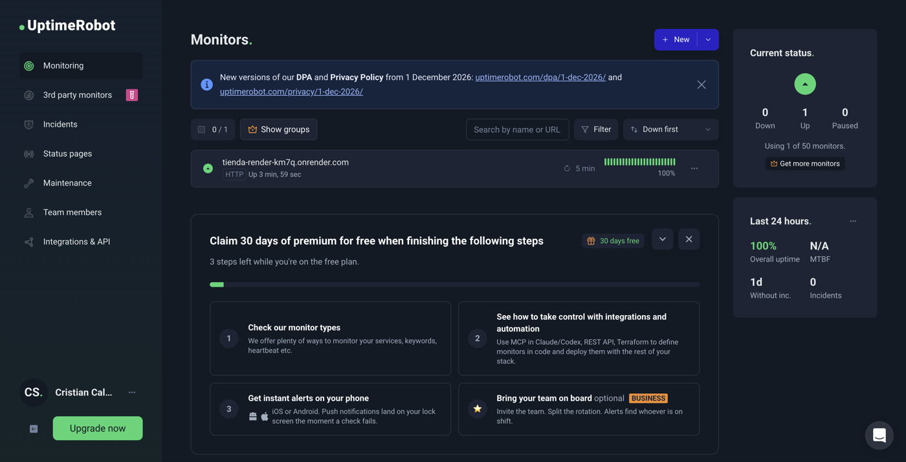

6. Haz clic en él para ver el detalle. Revisa que diga **HTTP/S monitor for https://...onrender.com/api/health** y **Checked every 5m**.

   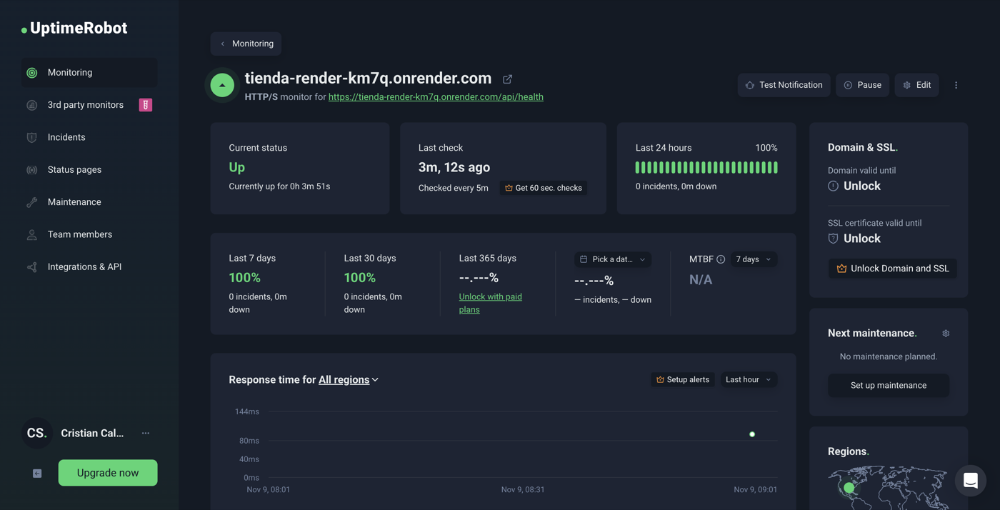

<details>
<summary>¿Ya tenías cuenta en UptimeRobot, o no te creó el monitor? Créalo a mano.</summary>

1. En **Monitoring**, presiona **+ New**.
2. **Monitor type:** HTTP / website monitoring. **URL to monitor:** el campo ya trae `https://` escrito: **bórralo** y pega tu URL completa, `https://TU-URL.onrender.com/api/health` (si no, queda `https://https://...`).

   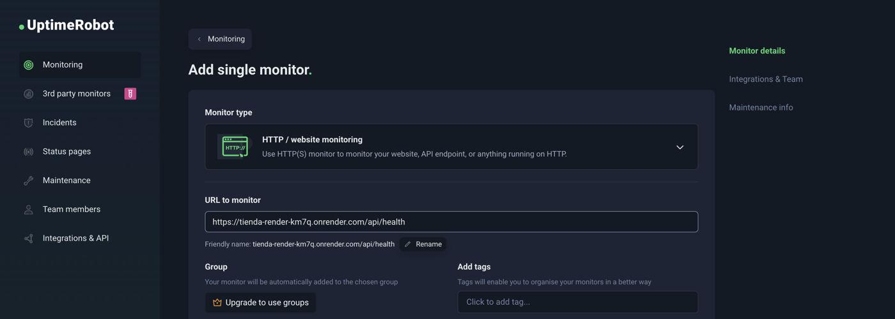

3. Baja hasta **Monitor interval** y deja **5m** (los intervalos menores son pagados).

   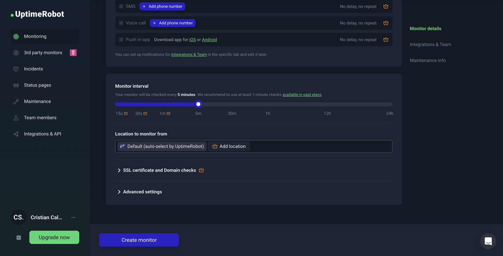

4. Presiona **Create monitor**.
</details>

**¿Por qué `/api/health` y no otra ruta?**
- `/api/health` responde sin consultar la base de datos. Si el robot llamara a `/api/productos`, despertaría a **Neon** cada 5 minutos y gastaría sus horas gratis.
- No uses `/robots.txt`: mientras tu servicio duerme, Render responde esa ruta por su cuenta y **no lo despierta**.

**Ojo con las horas gratis:** Render da **750 horas Free al mes por workspace** (tu cuenta trae uno: *My Workspace*). Un servicio despierto todo el mes usa unas 744: cabe justo. **Dos servicios despiertos no caben** y Render suspende todos tus servicios Free hasta el mes siguiente. Por eso: **un solo servicio con robot por cuenta**, y una cuenta por equipo.

¿Creaste un servicio de más? Entra a él → **Settings** → al final, **Delete Web Service** → escribe la frase que pide (`sudo delete web service NOMBRE`) → confirma.

## Paso 9: La app React Native consumiendo tu API

La carpeta `app-movil/` es una app Expo que lista, crea y borra productos, y muestra el código de cada respuesta.

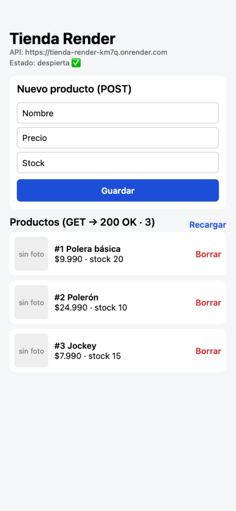

### 9.1 Apuntar la app a TU API

Abre `app-movil/src/api.js` y cambia **solo** esta línea por tu URL (sin `/` al final):

```js
export const API_URL = 'https://tienda-los-tres.onrender.com';
```

Todas las llamadas están en ese archivo. Por ejemplo, crear un producto:

```js
export async function crearProducto(producto) {
  const res = await fetch(`${API_URL}/api/productos`, {
    method: 'POST',                                   // el método
    headers: { 'Content-Type': 'application/json' },  // "te mando JSON" (sin esto: 415)
    body: JSON.stringify(producto),                   // el objeto JS convertido a texto JSON
  });
  const data = await res.json();
  if (res.status === 400) throw { status: 400, campos: data.campos ?? {}, mensaje: data.mensaje };
  if (!res.ok) throw new Error(`Error ${res.status}`);
  return data; // 201: el producto con su id
}
```

`res.ok` es `true` para los códigos 200 a 299. Para el `DELETE` (204) **no** se llama a `res.json()`, porque la respuesta viene vacía.

### 9.2 Ejecutarla

En una terminal (en VS Code: **Terminal → New Terminal**):

```bash
cd app-movil
npm install
npx expo start
```

- **En tu celular:** abre **Expo Go** y escanea el código QR que aparece en la terminal (en iPhone, escanéalo con la cámara).
- **En el navegador del PC:** presiona la tecla `w` en la terminal.

Si el celular no conecta (redes distintas, wifi de Duoc con restricciones), detén con **Ctrl+C** y prueba en este orden:

1. **Hotspot:** activa *compartir datos* en tu celular, conecta el PC a esa red y vuelve a ejecutar `npx expo start`. Funciona porque la API está en internet.
2. **Túnel:** crea una cuenta gratis en https://expo.dev, ejecuta `npx expo login` y luego `npx expo start --tunnel`.
3. Si nada resulta, presiona `w` y usa la app en el navegador.

> **Windows:** si PowerShell dice que *la ejecución de scripts está deshabilitada*, escribe `npx.cmd` en vez de `npx`, o cambia la terminal de VS Code a **Command Prompt** (flecha junto al **+** de la terminal).

### 9.3 Probar los códigos desde la app

| Acción en la app | Código | Qué muestra |
|---|---|---|
| Abrir la app | 200 | `Productos (GET → 200 OK · N)`, la lista y "Estado: despierta ✅" |
| Guardar con el nombre vacío y precio `-1` | 400 | El mensaje de **cada campo** bajo su input |
| Guardar un producto válido | 201 | `201 Created: producto #N guardado en Neon` |
| Borrar **el producto que acabas de crear** (no los #1, #2, #3) | 204 | Pide confirmación y luego `204 No Content: producto #N eliminado` |

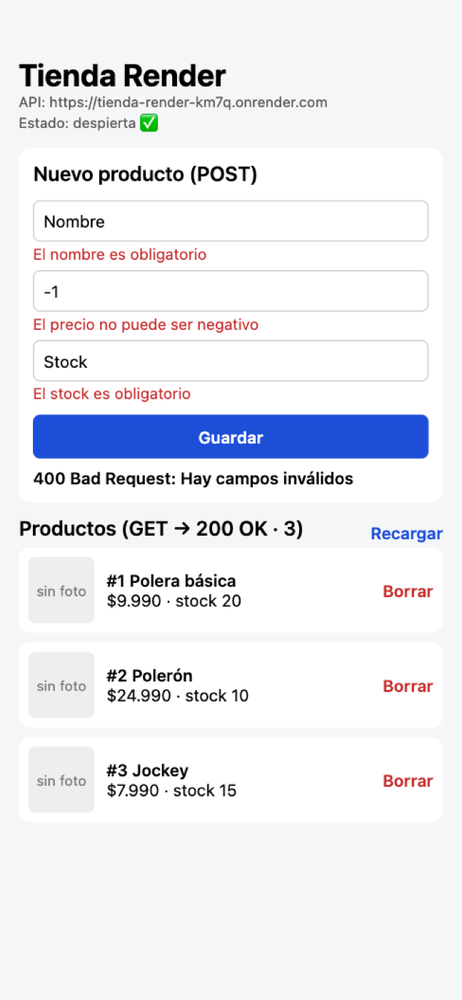
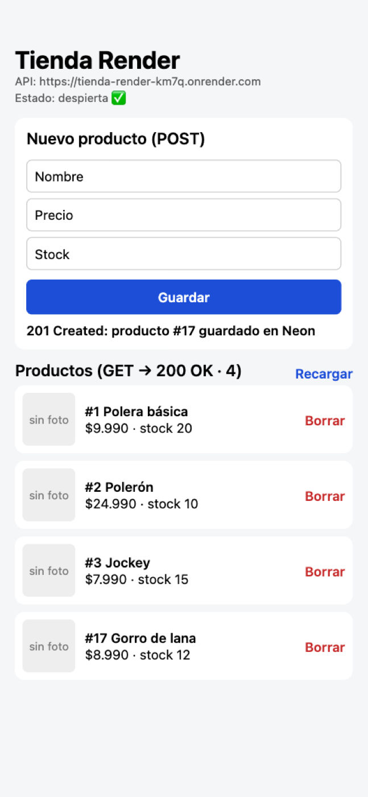
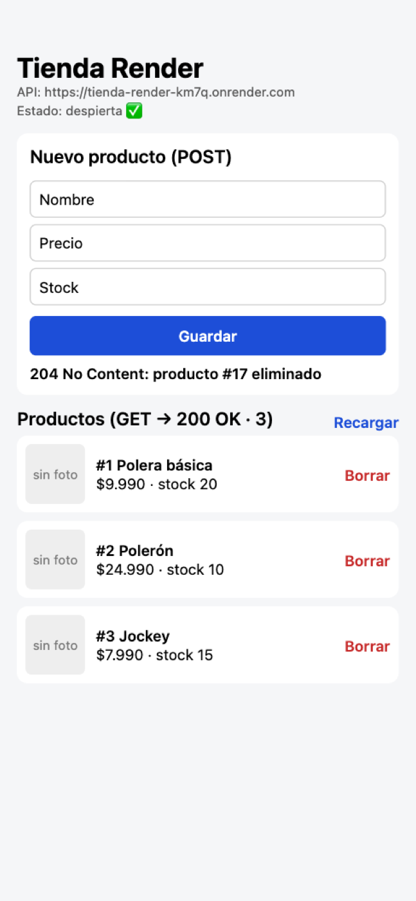

En iPhone el teclado de Precio y Stock trae la tecla `-` en la fila de símbolos.

> **CORS** solo existe en navegadores. La app en Expo Go no lo necesita. Si usas la versión web (`w`) ya está permitido, **siempre que la barra del navegador diga `localhost:8081`** (si Expo te ofrece otro puerto es porque quedó otro `expo start` abierto: ciérralo). Si tu frontend web usa otro puerto, en Render → **Environment** → **Edit** → **Add variable**: key `CORS_ORIGINS`, value con la lista **completa**, por ejemplo `http://localhost:8081,http://localhost:5173`. Presiona **Save, rebuild, and deploy**.

---

## Problemas frecuentes

| Síntoma | Causa | Solución |
|---|---|---|
| El deploy falla en `RUN mvn ... package` | Tu código no compila. | Ejecútalo primero en tu PC. Lee en los logs la línea `[ERROR]` con el archivo y la línea. |
| `'url' must start with "jdbc"` | Falta la variable `DB_URL`, su nombre está mal escrito, o el valor no empieza con `jdbc:postgresql://`. | **Environment** → revisa que existan `DB_URL`, `DB_USERNAME` y `DB_PASSWORD`, con ese nombre exacto. |
| `password authentication failed for user` | Clave equivocada, alguien presionó **Reset password** en Neon, o falta la variable `DB_USERNAME`/`DB_PASSWORD` (si dice `user '${DB_USERNAME}'`, falta esa variable). | Copia de nuevo la clave desde Neon y actualízala en **Environment** → **Save, rebuild, and deploy**. |
| `The connection attempt failed` / `UnknownHostException` | `DB_URL` mal armada. | Debe ser `jdbc:postgresql://HOST/neondb?sslmode=require`, sin comillas ni espacios. |
| `No open ports detected` / el deploy queda en *In progress* y falla por *timed out* | Spring no escucha en el puerto que Render espera (mira en los logs `Tomcat started on port ...`) o tardó demasiado en arrancar. | En `application.properties`: `server.port=${PORT:8080}`. Si el puerto está bien, presiona **Manual Deploy → Deploy latest commit**. |
| `release version 21 not supported` | Tu `pom.xml` usa Java 21 y el `Dockerfile`, Java 17. | En el `Dockerfile` usa `maven:3.9-eclipse-temurin-21` y `eclipse-temurin:21-jre`. |
| `/api/health` da 404 o el deploy falla en el *health check* | `SaludController` quedó fuera del paquete de tu clase `...Application`. | Muévelo a una subcarpeta de ese paquete y corrige la línea `package` (Opción B, paso 1). |
| `Exited with status 137` o `OutOfMemoryError` | Java usó más de los 512 MB del plan Free. | Usa el `Dockerfile` de esta plantilla (limita la memoria con `JAVA_TOOL_OPTIONS`). |
| La primera petición tarda ~1 minuto | La API estaba dormida. | Normal sin robot. Configura UptimeRobot (paso 8). |
| `502 Bad Gateway` justo después de un `git push` | Render está desplegando la versión nueva. | Espera a que el deploy termine (**Events**). |
| UptimeRobot marca **Down** | La API se cayó o la URL del monitor está mal. | Abre tu URL `/api/health` en el navegador y mira los **Logs** de Render. |
| Render dice que tus servicios están suspendidos | Se acabaron las 750 horas del mes (¿dos servicios con robot?). | Deja un solo servicio con robot. Las horas se renuevan el día 1. |
| La app dice `Network request failed` | `API_URL` mal escrita o el celular sin internet. | Debe empezar con `https://`. Ábrela en el navegador del celular para probarla. |
| La app dice `Error 404` al cargar | `API_URL` termina en `/` (queda `//api/productos`). | Quita la `/` final. |
| En el navegador: `Failed to fetch` y "Estado: no responde ❌" | CORS: Expo quedó en otro puerto, o tu backend (Opción B) no permite el 8081. | Usa `localhost:8081`, o agrega `CORS_ORIGINS` (ver nota CORS del paso 9.3). |
| `npx expo start --tunnel`: *You're not logged in to your Expo account* | El túnel necesita cuenta de Expo. | `npx expo login`, o usa el hotspot del celular (paso 9.2). |
| PowerShell: *la ejecución de scripts está deshabilitada* | Windows bloquea `npx.ps1`. | Usa `npx.cmd`, o la terminal **Command Prompt**. |
| Expo Go: *Project is incompatible with this version of Expo Go* | Tu Expo Go no es para SDK 58. | Actualiza Expo Go desde la tienda. |
| En el navegador: `blocked by CORS policy` | Tu frontend web usa un puerto no permitido. | Agrega `CORS_ORIGINS` en **Environment** (ver paso 9.3). |
| El servicio desplegó una versión vieja | El `push` fue a otra rama. | Render despliega `main`. Revisa con `git branch`. |

## Ejecutar en tu PC (igual que en la Clase 1)

Crea el `.env` junto a `pom.xml` con tus 3 datos de Neon y ejecuta `TiendaNeonApplication.java` con **Run**, o `./mvnw spring-boot:run` (Windows PowerShell: `.\mvnw.cmd spring-boot:run`). La API queda en `http://localhost:8080`.

Pruebas automáticas (usan la base del `.env`): `./mvnw test`. Revisan las rutas, los códigos 200/201/204/400/404/405/415, los mensajes de validación, `/api/health` y CORS.

## Estructura

```
tienda-render/
├── Dockerfile                    receta para Render (Maven compila, Java 17 ejecuta)
├── pom.xml
├── src/main/java/cl/duoc/tiendaneon/
│   ├── producto/
│   │   ├── Producto.java             entidad (tabla productos) + validaciones
│   │   ├── ProductoRepository.java   acceso a Neon (JPA arma el SQL)
│   │   └── ProductoController.java   las rutas /api/productos
│   ├── salud/SaludController.java    GET /api/health (no toca la BD)
│   └── config/
│       ├── ManejadorErrores.java     todos los errores en el mismo JSON
│       ├── CorsConfig.java           orígenes web permitidos
│       └── DatosIniciales.java       3 productos de ejemplo si la tabla está vacía
├── src/main/resources/application.properties
├── app-movil/                    app React Native (Expo SDK 58)
│   ├── App.js                        pantalla: lista, formulario, borrar
│   └── src/api.js                    TODAS las llamadas a la API (cambia API_URL aquí)
├── clase2/ACTIVIDAD.md           actividad de la Clase 2
└── docs/img/                     capturas de esta guía
```
